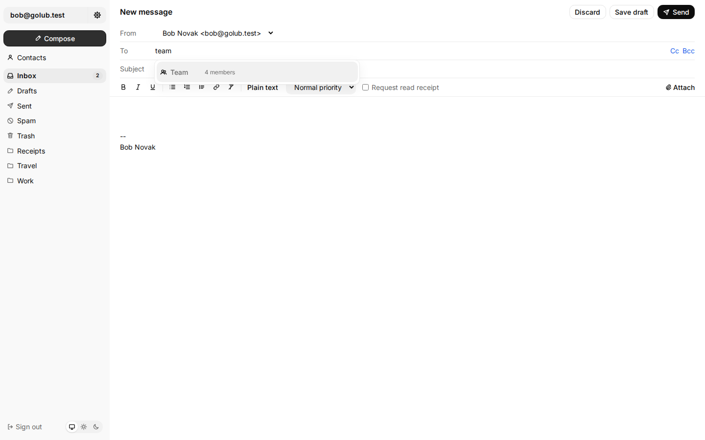

<p align="center">
  
</p>

<h1 align="center">Golub</h1>

<p align="center">
  Privacy-first webmail in a single Go binary.<br>
  No database, no tracking, nothing stored on the server.
</p>

<p align="center">
  <a href="https://github.com/stefanpejcic/Golub/releases"></a>
  <a href="https://github.com/stefanpejcic/Golub/actions/workflows/ci.yml"></a>
  <a href="https://github.com/stefanpejcic/Golub/pkgs/container/golub"></a>
  <a href="https://github.com/stefanpejcic/Golub/actions/workflows/ci.yml"></a>
  
  <a href="LICENSE"></a>
</p>

---

Golub (Serbian for *pigeon*, as in carrier pigeon) is a webmail client for any IMAP and SMTP server. It is built and tested against Dovecot and Postfix, with [docker-mailserver](https://github.com/docker-mailserver/docker-mailserver) as the reference stack.

It runs as one small container: no PHP, no database, no cron jobs, no plugins to keep in sync. Restart it whenever you like; there is nothing to migrate.


<table>
  <tr>
    <td></td>
    <td></td>
  </tr>
  <tr>
    <td align="center">Dark theme</td>
    <td align="center">Compose with contact and group suggestions</td>
  </tr>
  <tr>
    <td></td>
    <td align="center">
      
      
    </td>
  </tr>
  <tr>
    <td align="center">Contacts and groups</td>
    <td align="center">Mobile</td>
  </tr>
</table>

## Privacy first

Webmail sees everything a person writes and reads, so Golub is built to keep as little as possible and to leak nothing.

- **Nothing stored on the server.** No database and no files written at runtime. The session lives in an encrypted cookie; **settings, contacts and signatures are kept in the user's own mailbox**, in hidden IMAP folders that travel with the account.
- **No tracking, no analytics, no third-party requests.** Fonts, icons and scripts are all served by Golub itself. There is no telemetry.
- **Remote images are blocked by default.** When the user allows them, they load through Golub's image proxy, so senders never see the reader's IP address or browser. The proxy refuses private and internal addresses.
- **Tracking pixels are removed**, even when remote images are allowed, and the message view says how many were blocked.
- **HTML mail is sanitized on the server** and shown in a sandboxed frame with no scripts and a strict Content Security Policy.
- **Unsubscribe without exposing the reader.** One-click unsubscribe (RFC 8058) is sent from the server, not the browser.
- **End-to-end encryption with OpenPGP.** Encrypting, signing and decrypting happen in the browser. The private key is stored only passphrase protected, in the user's own mailbox, so neither the server nor anyone reading the mailbox can use it.
- **Read receipts are never sent silently.** The user is asked each time.
- **Nothing identifying in outgoing mail.** No `User-Agent` or `X-Mailer` header is added.
- **Not indexed.** Pages carry `noindex` and `robots.txt` disallows everything.

## Features

**Mail**
- Three-pane layout with resizable columns, light and dark themes, and a mobile layout
- Folders with unread counts, sizes and quota; create, rename, delete, empty and subscribe
- Server-side sorting and paging, fast on folders with tens of thousands of messages
- Threaded view (IMAP THREAD) as an option
- Search in subject and addresses, or also in the message text, in one folder or all of them, filtered by unread, flagged, attachments and dates
- Live updates through IMAP IDLE
- Drag and drop to folders, multi-select, swipe on touch screens, undo for moves and deletes
- Keyboard shortcuts for the list, messages, compose and settings

**Reading**
- Plain text and sanitized HTML, inline images, attachment download and preview (images, PDF, text)
- HTML mail shown dark in the dark theme, with pictures kept as they are, switchable per message
- Legacy charsets, broken MIME and Unicode addresses (`ime@pošta.rs`) handled
- Unsubscribe button for mailing lists, read receipt prompts, priority markers
- View the raw message and all headers

**Writing**
- Rich text or plain text, signatures per identity, canned responses
- Reply, reply all, forward inline or as attachment, drafts with autosave
- Address autocomplete from contacts, groups and people you have written to
- Priority and read receipt requests, browser spell check
- Unicode domains (IDNA) and mailboxes (SMTPUTF8)

**Encryption**
- OpenPGP encryption and signatures, compatible with Thunderbird, Mailvelope and other PGP/MIME clients
- Create or import keys, export them, and import other people's keys from a file, a paste or an attachment
- Decrypt in the browser after unlocking with the passphrase; keys lock again after 15 minutes
- Signed mail shows who signed it and whether the signature checks out

**Contacts**
- Address book with groups, collected recipients, vCard import and export

**Folders**
- Import `.eml` and `.mbox` files, export any folder as `.mbox`

**For hosting**
- One IMAP connection per user, kept open and reused, instead of a new login on every click
- Settings, contacts and signatures live on the IMAP server in the user's own mailbox, so they move with the account when it is migrated to another server
- Single sign-on from a control panel with a signed, single-use token
- Branding with your own name, logo and accent colour
- English, Serbian (Latin) and Arabic, with right-to-left support and more languages easy to add

## Benchmarks

### Golub and Roundcube

**42× smaller image, 9× less memory, 9× faster message list and 200× fewer IMAP connections than Roundcube.**

Both clients read the same mailbox on the same server: an INBOX of 21 messages and a folder of 50,000.

| | Golub 0.1.0 | Roundcube 1.7.7 | Difference |
|---|---|---|---|
| Image download (amd64) | **6.6 MB** | 281 MB | **42× smaller** |
| Image unpacked | **16.9 MB** | 795 MB | **47× smaller** |
| RAM at idle | **4.6 MB** | 35.5 MB | **8× less** |
| Peak RAM, 10 users | **15.8 MB** | 149.7 MB | **9× less** |
| Message list, INBOX, 10 users | **484 req/s**, 20 ms | 51 req/s, 195 ms | **9× faster** |
| Message list, 50,000 messages, 10 users | **64 req/s**, 148 ms | 23 req/s, 432 ms | **3× faster** |
| IMAP connections for 2,000 requests | **10** | 2,000 | **200× fewer** |
| Login page download | **39 KB**, 6 requests | 331 KB, 12 requests | **8× smaller** |
| Sign in to inbox shown | **0.94 s** | 1.37 s | **1.5× faster** |
| Open a message | **0.33 s** | 0.94 s | **3× faster** |
| Whole session download | **245 KB**, 29 requests | 382 KB, 51 requests | **1.6× less** |

Golub **keeps one IMAP connection per user open and reuses it**, where Roundcube connects and logs in to IMAP again on every request. That is less work and fewer connections for the mail server, and no "maximum number of connections" errors when one user has several tabs open.

How it was measured, on 27 November 2026: a 4-core VPS that also runs OpenPanel, docker-mailserver 17, and the official Roundcube image with its defaults (Apache and SQLite). The load rows come from ten different accounts, each sending 200 requests one after another with ApacheBench; peak RAM is the container's cgroup peak. The page rows are medians of five runs in Chromium over a link with about 120 ms latency, so they include the network. The setup is in [`e2e/bench`](e2e/bench).

## Quick start

Golub needs an IMAP and SMTP server. Point it at your mail server by the name on its TLS certificate:

```yaml
services:
  golub:
    image: ghcr.io/stefanpejcic/golub:stable
    restart: unless-stopped
    ports:
      - "8080:8080"
    environment:
      GOLUB_IMAP_HOST: mail.example.com
      GOLUB_IMAP_TLS: implicit          # port 993
      GOLUB_SMTP_TLS: implicit          # port 465
      GOLUB_SECRET_KEY: "change-me"     # openssl rand -base64 32
```

If Golub and the mail server share a private network and the server has no certificate, use `GOLUB_IMAP_TLS: none` and `GOLUB_SMTP_TLS: none` with the server's container name; Golub only allows unencrypted connections to private addresses.

Then open `http://localhost:8080` and sign in with a mailbox address and password.

Put Golub behind your reverse proxy for HTTPS, and set `GOLUB_TRUST_PROXY` to the proxy's address so it sees the real client IP and protocol. Golub can also serve HTTPS itself with `GOLUB_TLS_CERT` and `GOLUB_TLS_KEY`.

Images are published for `linux/amd64` and `linux/arm64`, signed with cosign and carry an SBOM and build provenance. `GET /healthz` reports the running version.

Every CI build is scanned with [Trivy](https://trivy.dev) and fails on a high or critical vulnerability that has a fix.

## Configuration

All settings come from environment variables and are checked at startup; a wrong value stops Golub with a message naming the variable.

| Variable | Default | Notes |
|---|---|---|
| `GOLUB_LISTEN` | `:8080` | |
| `GOLUB_IMAP_HOST` | | Required. |
| `GOLUB_IMAP_PORT` | 993 / 143 | Depends on `GOLUB_IMAP_TLS`. |
| `GOLUB_IMAP_TLS` | `starttls` | `implicit`, `starttls` or `none` (private addresses only). |
| `GOLUB_SMTP_HOST` | IMAP host | |
| `GOLUB_SMTP_PORT` | 465 / 587 | Depends on `GOLUB_SMTP_TLS`. |
| `GOLUB_SMTP_TLS` | `starttls` | Same as IMAP. |
| `GOLUB_TLS_CA` | | Extra CA bundle for mail servers with private certificates. |
| `GOLUB_SECRET_KEY` | | Required. Encrypts sessions: `openssl rand -base64 32`. |
| `GOLUB_SESSION_TTL` | `12h` | |
| `GOLUB_TLS_CERT`, `GOLUB_TLS_KEY` | | Serve HTTPS. Both or neither; reloaded when the files change and on SIGHUP. |
| `GOLUB_TRUST_PROXY` | | Comma-separated CIDRs allowed to set `X-Forwarded-*`. |
| `GOLUB_SSO_SECRET` | | Enables single sign-on. At least 32 characters. |
| `GOLUB_MASTER_USER`, `GOLUB_MASTER_PASSWORD` | | Dovecot master user, required with SSO. |
| `GOLUB_DEFAULT_LOCALE` | `en` | `en`, `sr-Latn` or `ar`. |
| `GOLUB_DEFAULT_THEME` | `system` | `system`, `light` or `dark`. |
| `GOLUB_BRAND_NAME` | `Golub` | Shown in the tab title and on the login page. |
| `GOLUB_BRAND_LOGO` | | Path to a `.png`, `.jpg`, `.svg` or `.webp` logo, up to 512 KB. |
| `GOLUB_BRAND_ACCENT` | | Accent colour for buttons, like `#2563eb`. |
| `GOLUB_LOG_LEVEL` | `info` | `debug`, `info`, `warn` or `error`. |

## Single sign-on

A control panel can log its users straight into their mailbox. Set `GOLUB_SSO_SECRET` and a Dovecot master user (`GOLUB_MASTER_USER`, `GOLUB_MASTER_PASSWORD`; in docker-mailserver this is `config/dovecot-masters.cf`). The panel then signs a short-lived token and redirects the browser to `/sso?token=...`.

The token is `base64url(payload) + "." + base64url(HMAC-SHA256(secret, payload))`, where the payload is:

```
email|expires|nonce|lang|theme
```

- `expires` is a Unix timestamp at most 60 seconds ahead
- `nonce` is random, at least 16 characters; each token works once
- `lang` and `theme` are optional and set the user's language and theme

In PHP:

```php
$payload = implode('|', [$email, time() + 60, bin2hex(random_bytes(16)), 'en', 'system']);
$b64 = fn ($s) => rtrim(strtr(base64_encode($s), '+/', '-_'), '=');
$token = $b64($payload) . '.' . $b64(hash_hmac('sha256', $payload, $secret, true));
header('Location: https://mail.example.com/sso?token=' . $token);
```

## Updating

Golub keeps no state, so updating is pulling a newer image and recreating the container. Pin an exact version in production and check `/healthz` after the update.

## Development

```
cd web && npm ci && npm run build && cd ..
go test -race ./...
go run ./cmd/golub
```

The frontend is Svelte and builds into `internal/ui/dist`, which the Go binary embeds. End-to-end tests run Playwright against docker-mailserver; see [`e2e/`](e2e). The README screenshots are made by `e2e/screenshots/shots.mjs` from invented demo mail.

Golub follows [semantic versioning](https://semver.org). `VERSION` holds the next release; builds in between report `X.Y.Z-dev.N`.

## Translations

Golub ships in English, Serbian (Latin) and Arabic. Arabic switches the whole interface to right to left; message text picks its own direction in every language.

Each language is one JSON file in [`web/src/locales`](web/src/locales), keyed by message id, with English (`en.json`) as the source:

```json
"compose.send": "Send",
"folders.unread": { "one": "{count} unread message", "other": "{count} unread messages" }
```

- Words in braces such as `{count}` or `{folder}` are filled in by Golub: keep them, but move them wherever the sentence needs them.
- Messages that depend on a number list every plural form your language has, the ones `Intl.PluralRules` reports: English has `one` and `other`, Serbian adds `few`, Arabic uses `zero`, `one`, `two`, `few`, `many` and `other`.
- A missing key falls back to English, so a partial translation still works.

**To fix or finish a translation**, edit its file and run the check, which reports missing or unknown keys and missing plural forms:

```
cd web && npm ci && node scripts/check-locales.mjs
```

**To add a language**, copy `en.json` to the new language code (for example `de.json`), translate it, add it to `catalogs` in [`web/src/lib/locale.svelte.ts`](web/src/lib/locale.svelte.ts) and to `Locales` in [`internal/config/config.go`](internal/config/config.go), and add a `language.<code>` entry with the language's own name to every file. Right-to-left languages are recognised by code in `textDirection` in [`web/src/lib/i18n.ts`](web/src/lib/i18n.ts).

Send the change as a pull request. The Arabic translation was made without a native speaker, so corrections there are especially welcome.

## Roadmap

<details>
<summary><b>Notifications and avatars</b></summary>

- Unread count in the tab title, kept up to date while the tab is in the background
- Favicon dot for new mail and optional desktop notifications
- Avatars: initials in a stable colour by default, no network requests
- BIMI logos for senders whose mail passed DMARC, loaded through the image proxy
- Optional Gravatar, off by default and loaded through the proxy

</details>

<details>
<summary><b>AI assistant (optional, privacy first)</b></summary>

Off unless the admin points Golub at an OpenAI-compatible endpoint, so a local Ollama or vLLM works. Nothing leaves the server unless the user clicks an AI action: no background analysis, nothing stored, and users can turn it off.
- Summarize a message or a long thread
- Reply suggestions: two or three short drafts to edit in compose
- Compose helpers: rewrite, shorten, fix grammar, change tone, translate
- Translate an incoming message in place
- Natural-language search turned into IMAP SEARCH ("invoices from Marko last month")
- Pull out action items, dates and deadlines from a message
- Explain why a message looks like phishing or spam
- Admin limits: per-user rate limit, maximum input size, attachments and quoted history left out

</details>

## License

GPL-3.0-or-later. See [LICENSE](LICENSE).
