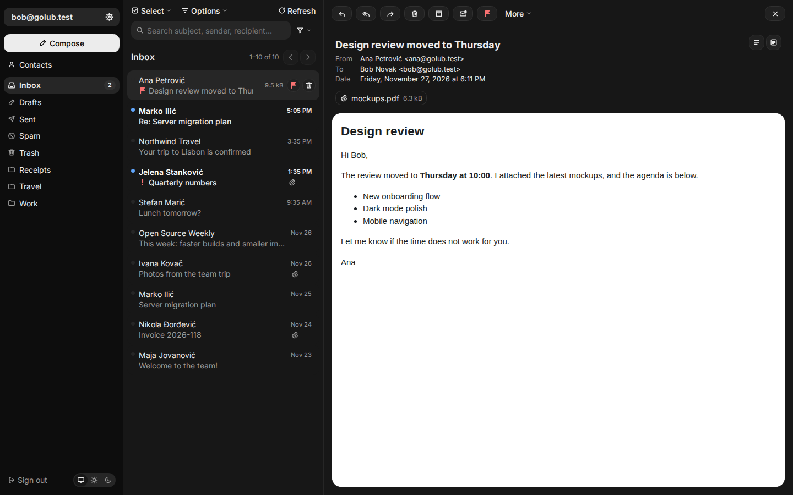
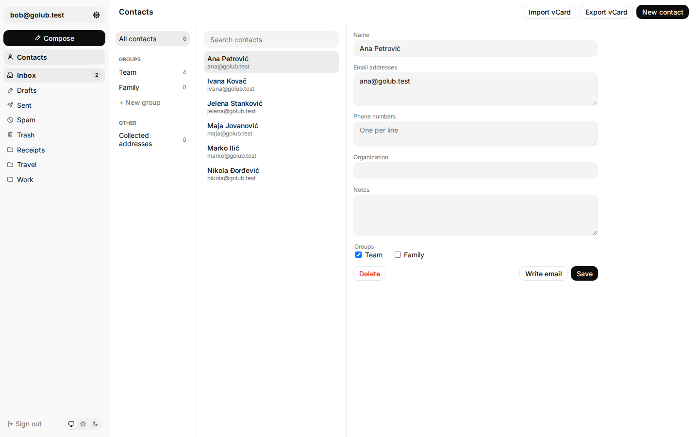
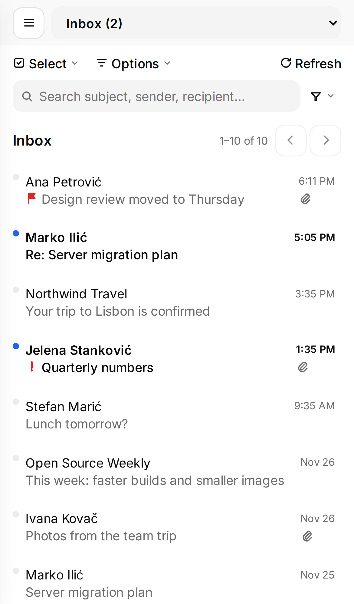

<p align="center">
  
</p>

<h1 align="center">Golub</h1>

<p align="center">
  Privacy-first webmail in a single Go binary.<br>
  No database, no tracking, nothing stored on the server.
</p>

---

Golub (Serbian for *pigeon*, as in carrier pigeon) is a webmail client for any IMAP and SMTP server. It is built and tested against Dovecot and Postfix, with [docker-mailserver](https://github.com/docker-mailserver/docker-mailserver) as the reference stack.

It runs as one small container: no PHP, no database, no cron jobs, no plugins to keep in sync. Restart it whenever you like; there is nothing to migrate.

Golub was developed as the default webmail client for [OpenPanel](https://openpanel.com) and open-sourced so anyone can use it with their own mail stack.


<table>
  <tr>
    <td></td>
    <td></td>
  </tr>
  <tr>
    <td align="center">Dark theme</td>
    <td align="center">Compose with contact and group suggestions</td>
  </tr>
  <tr>
    <td></td>
    <td align="center">
      
      
    </td>
  </tr>
  <tr>
    <td align="center">Contacts and groups</td>
    <td align="center">Mobile</td>
  </tr>
</table>

## Privacy first

Webmail sees everything a person writes and reads, so Golub is built to keep as little as possible and to leak nothing.

- **Nothing stored on the server.** No database and no files written at runtime. The session lives in an encrypted cookie; settings, contacts and signatures are kept in the user's own mailbox, in hidden IMAP folders that travel with the account.
- **No tracking, no analytics, no third-party requests.** Fonts, icons and scripts are all served by Golub itself. There is no telemetry.
- **Remote images are blocked by default.** When the user allows them, they load through Golub's image proxy, so senders never see the reader's IP address or browser. The proxy refuses private and internal addresses.
- **Tracking pixels are removed**, even when remote images are allowed, and the message view says how many were blocked.
- **HTML mail is sanitized on the server** and shown in a sandboxed frame with no scripts and a strict Content Security Policy.
- **Unsubscribe without exposing the reader.** One-click unsubscribe (RFC 8058) is sent from the server, not the browser.
- **Read receipts are never sent silently.** The user is asked each time.
- **Nothing identifying in outgoing mail.** No `User-Agent` or `X-Mailer` header is added.
- **Not indexed.** Pages carry `noindex` and `robots.txt` disallows everything.

## Features

**Mail**
- Three-pane layout with resizable columns, light and dark themes, and a mobile layout
- Folders with unread counts, sizes and quota; create, rename, delete, empty and subscribe
- Server-side sorting and paging, fast on folders with tens of thousands of messages
- Threaded view (IMAP THREAD) as an option
- Search in subject and addresses, or also in the message text, in one folder or all of them, filtered by unread, flagged, attachments and dates
- Live updates through IMAP IDLE
- Drag and drop to folders, multi-select, swipe on touch screens, undo for moves and deletes
- Keyboard shortcuts for the list, messages, compose and settings

**Reading**
- Plain text and sanitized HTML, inline images, attachment download and preview (images, PDF, text)
- Legacy charsets, broken MIME and Unicode addresses (`ime@pošta.rs`) handled
- Unsubscribe button for mailing lists, read receipt prompts, priority markers
- View the raw message and all headers

**Writing**
- Rich text or plain text, signatures per identity, canned responses
- Reply, reply all, forward inline or as attachment, drafts with autosave
- Address autocomplete from contacts, groups and people you have written to
- Priority and read receipt requests, browser spell check
- Unicode domains (IDNA) and mailboxes (SMTPUTF8)

**Contacts**
- Address book with groups, collected recipients, vCard import and export

**Folders**
- Import `.eml` and `.mbox` files, export any folder as `.mbox`

**For hosting**
- Single sign-on from a control panel with a signed, single-use token
- Branding with your own name, logo and accent colour
- English and Serbian (Latin), with more languages easy to add

## Quick start

Golub needs an IMAP and SMTP server. Point it at your mail server by the name on its TLS certificate:

```yaml
services:
  golub:
    image: ghcr.io/stefanpejcic/golub:stable
    restart: unless-stopped
    ports:
      - "8080:8080"
    environment:
      GOLUB_IMAP_HOST: mail.example.com
      GOLUB_IMAP_TLS: implicit          # port 993
      GOLUB_SMTP_TLS: implicit          # port 465
      GOLUB_SECRET_KEY: "change-me"     # openssl rand -base64 32
```

If Golub and the mail server share a private network and the server has no certificate, use `GOLUB_IMAP_TLS: none` and `GOLUB_SMTP_TLS: none` with the server's container name; Golub only allows unencrypted connections to private addresses.

Then open `http://localhost:8080` and sign in with a mailbox address and password.

Put Golub behind your reverse proxy for HTTPS, and set `GOLUB_TRUST_PROXY` to the proxy's address so it sees the real client IP and protocol. Golub can also serve HTTPS itself with `GOLUB_TLS_CERT` and `GOLUB_TLS_KEY`.

Images are published for `linux/amd64` and `linux/arm64`, signed with cosign and carry an SBOM and build provenance. `GET /healthz` reports the running version.

| Image | |
|---|---|
| Current release | `0.1.0` |
| Download size | 6.6 MB (amd64), 16.9 MB unpacked |
| Base | distroless static Debian 13, runs as a non-root user |
| Known vulnerabilities | none (Trivy 0.76.2, 27 November 2026) |

Every CI build is scanned with [Trivy](https://trivy.dev) and fails on a high or critical vulnerability that has a fix.

## Configuration

All settings come from environment variables and are checked at startup; a wrong value stops Golub with a message naming the variable.

| Variable | Default | Notes |
|---|---|---|
| `GOLUB_LISTEN` | `:8080` | |
| `GOLUB_IMAP_HOST` | | Required. |
| `GOLUB_IMAP_PORT` | 993 / 143 | Depends on `GOLUB_IMAP_TLS`. |
| `GOLUB_IMAP_TLS` | `starttls` | `implicit`, `starttls` or `none` (private addresses only). |
| `GOLUB_SMTP_HOST` | IMAP host | |
| `GOLUB_SMTP_PORT` | 465 / 587 | Depends on `GOLUB_SMTP_TLS`. |
| `GOLUB_SMTP_TLS` | `starttls` | Same as IMAP. |
| `GOLUB_TLS_CA` | | Extra CA bundle for mail servers with private certificates. |
| `GOLUB_SECRET_KEY` | | Required. Encrypts sessions: `openssl rand -base64 32`. |
| `GOLUB_SESSION_TTL` | `12h` | |
| `GOLUB_TLS_CERT`, `GOLUB_TLS_KEY` | | Serve HTTPS. Both or neither; reloaded when the files change and on SIGHUP. |
| `GOLUB_TRUST_PROXY` | | Comma-separated CIDRs allowed to set `X-Forwarded-*`. |
| `GOLUB_SSO_SECRET` | | Enables single sign-on. At least 32 characters. |
| `GOLUB_MASTER_USER`, `GOLUB_MASTER_PASSWORD` | | Dovecot master user, required with SSO. |
| `GOLUB_DEFAULT_LOCALE` | `en` | `en` or `sr-Latn`. |
| `GOLUB_DEFAULT_THEME` | `system` | `system`, `light` or `dark`. |
| `GOLUB_BRAND_NAME` | `Golub` | Shown in the tab title and on the login page. |
| `GOLUB_BRAND_LOGO` | | Path to a `.png`, `.jpg`, `.svg` or `.webp` logo, up to 512 KB. |
| `GOLUB_BRAND_ACCENT` | | Accent colour for buttons, like `#2563eb`. |
| `GOLUB_LOG_LEVEL` | `info` | `debug`, `info`, `warn` or `error`. |

## Single sign-on

A control panel can log its users straight into their mailbox. Set `GOLUB_SSO_SECRET` and a Dovecot master user (`GOLUB_MASTER_USER`, `GOLUB_MASTER_PASSWORD`; in docker-mailserver this is `config/dovecot-masters.cf`). The panel then signs a short-lived token and redirects the browser to `/sso?token=...`.

The token is `base64url(payload) + "." + base64url(HMAC-SHA256(secret, payload))`, where the payload is:

```
email|expires|nonce|lang|theme
```

- `expires` is a Unix timestamp at most 60 seconds ahead
- `nonce` is random, at least 16 characters; each token works once
- `lang` and `theme` are optional and set the user's language and theme

In PHP:

```php
$payload = implode('|', [$email, time() + 60, bin2hex(random_bytes(16)), 'en', 'system']);
$b64 = fn ($s) => rtrim(strtr(base64_encode($s), '+/', '-_'), '=');
$token = $b64($payload) . '.' . $b64(hash_hmac('sha256', $payload, $secret, true));
header('Location: https://mail.example.com/sso?token=' . $token);
```

## Updating

Golub keeps no state, so updating is pulling a newer image and recreating the container. Pin an exact version in production and check `/healthz` after the update.

## Development

```
cd web && npm ci && npm run build && cd ..
go test -race ./...
go run ./cmd/golub
```

The frontend is Svelte and builds into `internal/ui/dist`, which the Go binary embeds. End-to-end tests run Playwright against docker-mailserver; see [`e2e/`](e2e). The README screenshots are made by `e2e/screenshots/shots.mjs` from invented demo mail.

Golub follows [semantic versioning](https://semver.org). `VERSION` holds the next release; builds in between report `X.Y.Z-dev.N`. Plans live in [ROADMAP.md](ROADMAP.md).

## License

GPL-3.0-or-later. See [LICENSE](LICENSE).
